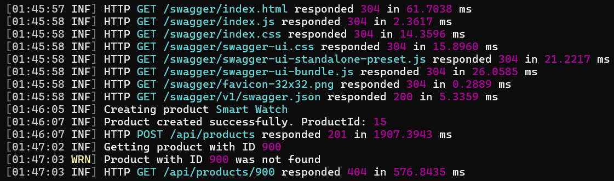

# Products API: Clean Architecture + CQRS (Huma Volve Task 3 & 4)

A Products REST API built with ASP.NET Core, following Clean Architecture and the CQRS pattern with MediatR.

## Swagger

## Tech Stack

- ASP.NET Core Web API
- Entity Framework Core + SQL Server
- MediatR (CQRS)
- Data Annotations validation
- Serilog (structured logging to console and rolling files)
  
## Architecture

| Project | Responsibility |
|---|---|
| `Products.Domain` | Entities (`Product`) |
| `Products.Application` | Commands, Queries, Handlers, DTOs, repository interface |
| `Products.Infrastructure` | EF Core `AppDbContext`, repository implementation, migrations |
| `Products.API` | Controllers, request DTOs, `Program.cs` (composition root) |

Dependencies point inward: API → Application → Domain, and Infrastructure → Application.
Logging: handlers in `Products.Application` depend only on `ILogger<T>`; Serilog is configured only in `Products.API`.

## Endpoints

| Method | Route | Description |
|---|---|---|
| GET | `/api/products` | Get all products |
| GET | `/api/products/{id}` | Get a product by id (404 if not found) |
| POST | `/api/products` | Create a product (201) |
| PUT | `/api/products/{id}` | Update a product (204 / 404) |
| DELETE | `/api/products/{id}` | Delete a product (204 / 404) |

## Validation

- `Name`: required, 2 to 100 characters
- `Price`: between 0.01 and 1,000,000

## Logging

Logging uses `ILogger<T>` in the application handlers, with Serilog as the provider in `Products.API`.

- **Sinks:** console and daily rolling files (`logs/log-YYYYMMDD.txt`, last 7 files kept)
- **Structured logging:** message templates with named properties, for example `Product created successfully. ProductId: {ProductId}`
- **Log levels:** `Information` for normal events, `Warning` for a missing product, `Debug` for request details
- **HTTP request logging:** `UseSerilogRequestLogging()` records the method, path, status code and duration of every request
- **Configuration:** everything lives in the `Serilog` section of `appsettings.json`; framework noise is reduced with `Microsoft` and `System` overrides set to `Warning`

## How to Run

1. Update the connection string in `Products.API/appsettings.json` if needed.
2. Apply the migration: `Update-Database` (Package Manager Console, default project `Products.Infrastructure`, startup project `Products.API`).
3. Run `Products.API` and open Swagger.
4. Logs appear in the console and in the `logs/` folder next to the running app (the folder is git-ignored).
